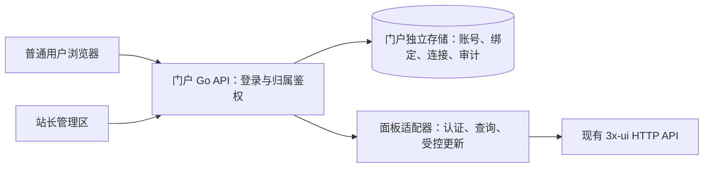

# 3x-ui 对接与用户自助

当前验证状态见 [验证记录](../验证记录.md)；下方早期静态检查记录仅为实施历史。
核查日期：2026-11-09。状态：**首版已构建并通过本地模拟验证；真实面板联调待完成。** 下文区分当前实现与后续扩展。

## 1. 结论和依据范围

可以在不修改当前 3x-ui 源码、不接触其数据库的前提下，开发独立用户端，支持独立登录、查询到期与流量、获取订阅、受限制的订阅重置和联系站长。面板地址及凭据由站长在用户端管理区配置，用户只访问用户端。

参考目录为同级 `3x-ui-main`，版本文件为 `3.11.0`；后端 Go + Gin + GORM，前端 React + TypeScript + Ant Design + Vite。本次不是对所有历史 3x-ui 版本的兼容承诺。用户实际部署版本未知，后续必须验证能力及契约，不能直接套用旧版 `inbounds/updateClient/:id` 示例。

当前源码已有基于订阅链接的信息页，展示到期、流量、订阅导入和支持入口；本项目增加的是独立账号、资源绑定、自助操作和独立站点管理。

## 2. 能力与接口

以下路径均相对管理员配置的完整面板基础地址。例如基础地址 `https://panel.example.invalid:8443/secret/` 对应 `.../secret/panel/api/clients/get`；保留路径前缀，避免 URL 合并时丢失它。示例仅为地址格式，不是真实连接信息。

| 能力 | 当前源码接口/实现 | 用户端处理 |
| --- | --- | --- |
| 客户端详情、到期、启停 | `GET /panel/api/clients/get?email=...`，也有路径参数形式 | 后端按账号绑定查询，返回筛选后的用户视图 |
| 流量 | `GET /panel/api/clients/traffic/:email` | 使用 up/down/total，不重复叠加详情中的 usedTraffic |
| 查询订阅覆盖的记录 | `GET /panel/api/clients/get/subId/:subId` | 返回数组；用于识别共享订阅及核实重置范围 |
| 获取订阅地址 | `GET /panel/api/clients/subLinks/:subId` | 使用面板生成的地址，核实对外域名、端口和路径 |
| 修改订阅标识 | `POST /panel/api/clients/update?email=...` 或 `/update/:email` | 当前版本可仅提交 `{"subId":"新随机标识"}`；执行前检查归属与限制 |
| API Token | `Authorization: Bearer ...` | 推荐服务端使用，当前上述完整接口需 admin scope |
| 账号密码 | `GET /csrf-token`、`POST /login` | cookie jar + `X-CSRF-Token`；启用 2FA 时还需验证码 |
| 联系站长 | 门户自身配置，或面板订阅信息的 `subSupportUrl` | 展示有效联系方式或支持链接；不自动向他人发送消息 |

接口响应需要同时判断 HTTP 状态、JSON 结构和 `success`。详情的业务对象包含 `client`、`inboundIds`、`externalLinks`、`usedTraffic`、`tunnelAllowedIPs`；不直接把整个对象透传给普通用户。

`monitor` token 只允许服务器/节点监控，不是用户数据只读令牌；node-sync/node-admin 也不能满足上述完整查询接口。门户后端持有较高权限凭据，必须自行按登录身份限制资源范围，不能公开通用面板 API 代理。

账号密码方式可用，但仅保存用户名密码不足以在开启 2FA 的面板上长期自动重登。首次连接和会话过期均需正确处理；优先 API Token，不要求关闭 2FA。Bearer 鉴权成功的 API 请求在当前源码中跳过会话 CSRF。

## 3. 建议架构与首期范围

当前只支持固定单面板配置，绑定保存在门户独立 SQLite。未来多面板需迁移增加 panelId，不在首期引入多站点计费、支付或完整工单系统。

业务职责：认证与会话、面板连接管理、账号绑定、用量查询、订阅操作、站点联系配置。HTTP 层只做输入输出适配；上游认证、路径和版本差异归面板适配器；账号归属判断集中在门户授权服务。

门户数据库仅保存自身数据：账号与密码哈希、面板连接、账号到客户端的绑定、站长配置、操作审计。固定面板内的客户端记录 ID 用于身份核对，email 作为当前 API 定位键；email 被面板改名时停止错误映射并由管理员重新核实，不能自动绑定到后来复用同名的客户端。subId 会重置，不能作为永久用户主键。

## 4. 角色、入口与操作顺序（已编写源码，待运行验收）

### 站长：管理 → 面板连接

首次安装填写名称、完整基础地址及 admin API Token，之后可在设置页替换密钥。当前不实现面板账号密码/2FA 登录模式。连接检查只做读取，不靠创建/删除客户端测试连通性。区分认证失败、权限不足、接口路径不匹配与网络/证书连接失败。安装与登录细节见 [安装与账户安全](安装与账户安全.md)。

订阅服务可与管理服务分离，优先读取面板生成的订阅链接；必要时另配公开订阅基础地址并校验，不把管理地址硬拼成订阅地址。

### 站长：管理 → 用户绑定

由站长创建门户账号并选择已有面板客户端绑定，生成一次性激活链接。普通用户首次验证邀请后必须自行设置本站密码，不允许输入任意 email 或 subId 自认归属；面板 email 不一定是真实邮箱。客户端搜索每次取前 20 项，门户用户列表分页，仅管理员可读。详见 [订阅中转与首次激活](订阅中转与首次激活.md)。

### 用户：首页

登录后查看绑定账号的启停、到期、剩余时间、流量和最后同步时间。默认每 15 秒请求一次门户摘要，前端避免同页面并发刷新；后端组合精确查询，当前未增加跨请求缓存。倒计时在浏览器每秒更新并用服务器时间校准。页面隐藏时暂停轮询，失败时保留可识别的旧数据和同步失败提示；首次获取失败仍显示来自登录会话的站长联系方式。

管理员调整到期后，下次成功同步更新倒计时。流量是近实时：本地源码中的 Xray 和节点统计任务为 5 秒周期，额外存在网络与门户轮询延迟，不能宣传秒级精确流量。

### 用户：订阅 → 复制/重置

当前展示“主用·本站中转”和“备用·原站直连”，复制后自行选择导入。中转以站长配置的来源为限，门户服务器必须能够访问面板 API 和原站订阅。重置前提示主用/备用都需重新导入、已导入节点凭据不会因此撤销。只有符合第 6 节限制时显示可用操作；提交中防重复，结果明确区分完成、失败及待核实。

### 用户：联系站长

站长配置支持网址、Telegram 或邮箱等渠道；用户点击跳转/复制即可。不需要修改面板。未配置时明确显示暂无联系方式，不显示无效按钮。支持地址校验协议，避免任意脚本链接。

## 5. 时间、流量与状态规则

- 原始客户端 `expiryTime > 0`：Unix 毫秒截止时间，剩余时间取截止时间减校准后的当前时间；已到期不显示负倒计时。
- `expiryTime = 0`：该记录不限期。
- `expiryTime < 0`：尚未首次使用激活，绝对值为激活后的有效毫秒时长。显示“未激活，首次使用后有效 N 天/小时”，不能计算固定截止日期。
- 流量为字节，`totalGB` 名称不等于数值单位为 GB；按实际字段契约转换展示。total 为 0 表示不限流量，避免除零。
- enabled、到期和流量耗尽分别保留事实；同步失败不等于过期或无套餐。
- 订阅 `expire` 和 `Subscription-Userinfo` 的时间单位为秒，与管理 API 毫秒不同。共享订阅的多记录到期不一致时，聚合 expire 可能为 0；不能据此断言每个记录永久有效。
- 同一门户账号绑定多个记录时按记录展示，不能随意把多个截止时间压成一个“到期日”。

## 6. 重置订阅：支持范围与一致性

当前版本支持部分字段更新，省略的字段由服务层补回。只传新 subId；使用安全随机生成的标识，服务端独立构造请求，禁止将用户输入任意透传到更新接口。

**首期仅支持一个 subId 对应一个 ClientRecord 的情况，该记录可以关联多个入站。** 历史共享 subId 能查到多个记录，但更新为新值时有碰撞检查：不能逐个将多条记录改成相同新 subId。共享场景暂停自助重置并提示联系站长，不用只改一条的方式制造“旧链接全部失效”的假象。后续若需要共享聚合，另行设计门户订阅服务。

**部分字段请求仍会经过完整客户端更新流程。** 上游会同步流量记录的 enable/total/expiry，并对绑定入站及运行时执行更新；可能出现部分失败或连接影响，不是单纯修改一个数据库字符串。

还存在状态恢复分支：正常一致的数据下，只改 subId 不会自动启用仍过期、超额或单纯手动停用的账号；但如果 ClientRecord 已是未来到期，而停用的流量记录仍保存旧到期日，上游可能将此次更新视为续期并自动启用。显式提交 `enable:false` 也不能消除该分支。

因此首版限制为：客户端及流量记录均启用、额度和期限一致且未耗尽、非未激活状态、1–8 个启用的本地入站，并且 OpenAPI 声明省略更新字段保持不变。远端节点、停用、过期、超额、流量记录缺失或状态不一致时转联系站长。默认关闭，由站长确认兼容性后开启。这些前置检查已写入源码，仍不能消除跨系统竞态。

当前源码操作流程：

1. 校验当前会话及绑定，读取客户端、流量和旧 subId 关联记录，确认归属、独占条件、启停及上述状态一致性要求。
2. 重新验证当前密码，进程内串行化写操作；写前再次读取并检查客户端和 subId 未漂移，在门户数据库以用户 ID 保存加密目标和保护字段指纹，状态置 pending。
3. 仅提交 subId 一次。失败或超时可能已发生部分变更，使用独立短时上下文读回；不盲目重试或回滚。响应有错即保守记为 review，即使 subId 已改变也需人工核实。
4. 读回确认绑定身份、subId、到期、配额、启停、入站及节点凭据等保护字段；成功记 confirmed，否则记 review。pending/review 阻止再次自助提交，页面刷新重新获取链接。审计为尽力写入。
5. 在允许的测试环境验证旧订阅不能再获得该账号配置。若外部代理缓存、远端节点或面板并发修改影响结果，说明状态并交由管理员核实。

上游更新不是跨多个 HTTP 请求的事务，门户锁也不能阻止站长在面板同时编辑。当前接口无已验证的条件更新保证，需读前/读后检查；遇到冲突停止自动处理。不能承诺绝对无竞态或外部客户端立即同步。

仅改 subId 会保留 UUID/password/auth/secret，所以重置订阅地址不是撤销已经导入的代理连接权限。泄漏后的节点凭据轮换属于另一个会影响连接的功能，不纳入本次“重置订阅地址”默认行为。

## 7. 源码证据索引

以下文件链接指向同级参考源码目录；行号为本次读取快照，源码变更后需重新定位。

| 核查事项 | 文件与定位 |
| --- | --- |
| 版本与技术栈 | [版本](../../../3x-ui-main/internal/config/version) 第 1 行；[go.mod](../../../3x-ui-main/go.mod) 第 1–3 行；[前端依赖](../../../3x-ui-main/frontend/package.json) |
| API 分组、Token 与权限 allowlist | [api.go](../../../3x-ui-main/internal/web/controller/api.go) 第 46、85、194、211 行 |
| 客户端路由、详情、共享查询、更新 | [client.go](../../../3x-ui-main/internal/web/controller/client.go) 第 53、134、196、265 行 |
| 部分字段更新与保留规则 | [client_partial_update.go](../../../3x-ui-main/internal/web/service/client_partial_update.go) 第 12–28 行 |
| 凭据保留、自动启用检查、subId 碰撞 | [client_crud.go](../../../3x-ui-main/internal/web/service/client_crud.go) 第 757、768、785、803 行 |
| 续期恢复判定与运行时副作用 | [client_renewal_reenable.go](../../../3x-ui-main/internal/web/service/client_renewal_reenable.go) 第 13–49 行；[client_inbound_apply.go](../../../3x-ui-main/internal/web/service/client_inbound_apply.go) 第 1049、1123–1186 行；[inbound_traffic.go](../../../3x-ui-main/internal/web/service/inbound_traffic.go) 第 625 行 |
| 多记录 subId 与字段定义 | [client_lookup.go](../../../3x-ui-main/internal/web/service/client_lookup.go) 第 108 行；[model.go](../../../3x-ui-main/internal/database/model/model.go) 第 992–1016 行 |
| 登录、CSRF 与 2FA | [index.go](../../../3x-ui-main/internal/web/controller/index.go) 第 23、46、51、128 行；[security.go](../../../3x-ui-main/internal/web/middleware/security.go) 第 38 行；[user.go](../../../3x-ui-main/internal/web/service/panel/user.go) 第 102 行 |
| 首次使用到期激活、累计流量 | [inbound_traffic.go](../../../3x-ui-main/internal/web/service/inbound_traffic.go) 第 260、1239 行 |
| 统计周期和路径前缀 | [web.go](../../../3x-ui-main/internal/web/web.go) 第 202、259、305、311 行 |
| 订阅页面、info、支持地址、缓存响应头 | [controller.go](../../../3x-ui-main/internal/sub/controller.go) 第 397、417、689、762、964 行 |
| 订阅聚合时间语义与实时查找 | [service.go](../../../3x-ui-main/internal/sub/service.go) 第 800、808、834 行 |
| 订阅缓存失效 | [client_inbound_apply.go](../../../3x-ui-main/internal/web/service/client_inbound_apply.go) 第 748 行；[service.go](../../../3x-ui-main/internal/sub/service.go) 第 114 行 |

## 8. 校验结果与后续验收

已读取路由、认证、字段更新、数据模型、订阅与统计实现，并进行独立只读核查；前后端、安装脚本与 SQLite 初始化 SQL 已交付，隔离数据库初始化、本地编译和模拟浏览器流程已通过。实际验证范围见 [验证记录](../验证记录.md)，未连接真实面板。

正式实现后的验收应在已确认并授权的测试环境完成：

- 完整 basePath、独立订阅端口、Token 权限、门户账号密码/CSRF 及会话失效；面板密码登录/2FA 留作后续扩展。
- 用户 A 无法读取或重置用户 B；email 改名、同名复用、绑定删除均不会越权。
- 永久、未激活、到期、耗尽、禁用、面板不可达、时区和客户端时钟偏差。
- 独占订阅重置后新地址可用、旧地址不再获取原配置，其他字段保留；已导入节点的行为与提示一致。
- 共享 subId、重复点击、超时已提交、面板并发修改和节点待同步正确反馈。
- 停用账户与流量记录状态漂移不会通过自助入口触发意外启用；运行时更新的连接影响已实测并正确提示。
- 手机布局、复制失败、联系信息缺失和错误后重试可恢复。

实际面板版本、能力及订阅公开地址待提供和验证；当前不把本地源码结论表述为线上已验证。
